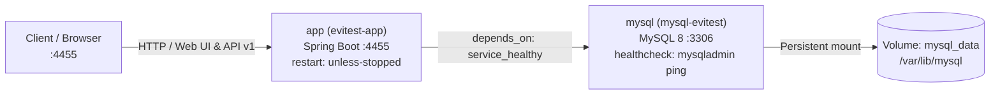

# Student Management System - REST API

A Spring Boot RESTful API for managing student records with full CRUD operations. Built with Spring Data JPA, Hibernate, and MySQL database.

---

## 📋 Table of Contents

- [Features](#features)
- [Tech Stack](#tech-stack)
- [Prerequisites](#prerequisites)
- [Installation](#installation)
- [Configuration](#configuration)
- [API Endpoints](#api-endpoints)
- [Testing with Postman](#testing-with-postman)
- [Postman Setup Guide](#postman-setup-guide)
- [Project Structure](#project-structure)
- [Database Schema](#database-schema)
- [Troubleshooting](#troubleshooting)
- [License](#license)

---

## ✨ Features

- ✅ **Create** - Add new student records
- ✅ **Read** - Retrieve all students or search by ID/Name
- ✅ **Update** - Modify student details (full & partial updates)
- ✅ **Delete** - Remove student records
- ✅ **MySQL Database** - Persistent data storage with automatic schema management
- ✅ **RESTful API** - Standard HTTP methods and status codes
- ✅ **Web UI Included** - Static frontend (`index.html`) available at `http://localhost:4455/` for browser-based CRUD testing
- ✅ **Error Handling** - Comprehensive exception management
- ✅ **Hot Reload** - Spring DevTools for faster development
- ✅ **Postman Ready** - All endpoints Postman-tested and documented

---

## 🛠️ Tech Stack

| Component | Version | Purpose |
|-----------|---------|---------|
| **Java** | 25 | Programming language |
| **Spring Boot** | 4.0.2 | Application framework |
| **Spring Data JPA** | Latest | ORM & Database access |
| **Hibernate** | Latest | JPA implementation |
| **MySQL** | 8.0+ | Database |
| **Lombok** | Latest | Reduce boilerplate code |
| **Maven** | 3.6+ | Build tool |
| **Postman** | Latest | API Testing Tool |

---

## 📦 Prerequisites
**Before you begin, ensure you have the following installed:**
**Docker Desktop:**
- docker --version
- docker compose version

**Git:**
- git --version

**Maven**
- mvn --version
- mvn clean package -DskipTests

---

## 🚀 Installation
### Step 1: Clone the Repository
- git clone https://github.com/IangonzalezM/spring-web-api-docker-compose-evi.git
- cd spring-web-api-docker-compose-evi/sbapp11
### Step 2: Create Environment File
**Copy:**
- .env.example 
- to:
- .env 
- and customize the database credentials if required.
**Example:**
- DB_URL=jdbc:mysql://mysql:3306/EVITest
- DB_USER=root
- DB_PASSWORD=root
- MYSQL_DATABASE=EVITest
- MYSQL_ROOT_PASSWORD=root
### Step 3: Build the Application
- mvn clean package -DskipTests
### Step 4: Build Docker Image
- docker build -t evitest-api .
### Step 5: Start the Environment
- docker compose up -d
### Step 6: Verify Containers
- docker ps
**Expected containers:**
- mysql-evitest
- evitest-app
### Step 7: Access the Web UI and API
- Web UI: http://localhost:4455/
- REST API: http://localhost:4455/api/v1/getStudent12

---
### 🐳 Docker Environment
**The project uses Docker Compose to orchestrate:**

- Spring Boot REST API
- MySQL 8 Database
- Persistent Docker Volume
- Start
- docker compose up -d
- View Logs
- docker compose logs -f
- Stop Containers
- docker compose down
- Remove Containers and Database Volume
- docker compose down -v
- Rebuild Everything
- mvn clean package -DskipTests
- docker build --no-cache -t evitest-api .
- docker compose up -d

#### Architecture Overview

```text
+-------------------------------------------------------+
|                   Host / Browser                      |
|        http://localhost:4455  |  :3306 (MySQL)        |
+---------------------------+---------------------------+
                            |
           Docker Compose Network (internal bridge)
  +-------------------------+-------------------------+
  |                                                   |
  v                                                   v
+-----------------------+                   +-----------------------+
|  Service: app         |  JDBC / TCP 3306  |  Service: mysql       |
|  evitest-app          | ----------------> |  mysql-evitest        |
|  Port: 4455:4455      | (waits healthy)   |  Image: mysql:8       |
|  restart:             |                   |  Port: 3306:3306      |
|  unless-stopped       |                   |  healthcheck: ping    |
+-----------------------+                   +-----------+-----------+
                                                        |
                                                        | Volume: mysql_data
                                                        v
                                            +-----------------------+
                                            | Persistent Storage    |
                                            | /var/lib/mysql        |
                                            +-----------------------+
```



#### Persistence & Recovery Verification

1. **Data Persistence Test:**
   - Insert a student record via Web UI (`http://localhost:4455/`) or `POST /api/v1/insertStudent12`.
   - Stop and remove containers without deleting volumes:
     ```bash
     docker compose down
     ```
   - Start the stack again:
     ```bash
     docker compose up -d
     ```
   - Query `GET http://localhost:4455/api/v1/getStudent12` and verify that previously stored records remain intact in `mysql_data`.

2. **Service Recovery Test:**
   - Simulate an application container stop/failure:
     ```bash
     docker stop evitest-app
     ```
   - Verify container recovery with `docker compose up -d` or automatic restart policy (`restart: unless-stopped`) using `docker compose ps`.

---

## ⚙️ Configuration

### Application Properties
File: `src/main/resources/application.properties`

```properties
**Server Configuration**
-
